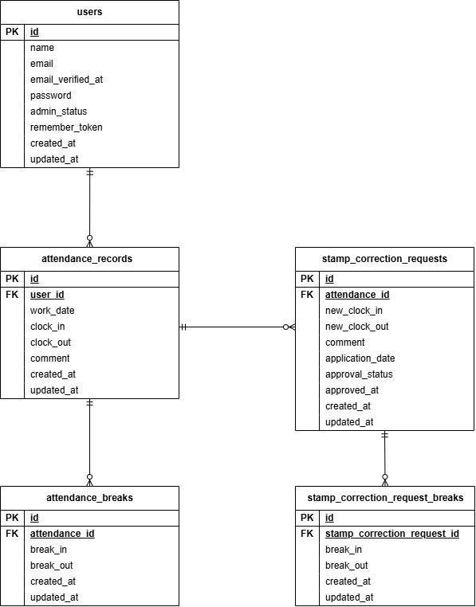

# COACHTECH 勤怠管理アプリ

## 開発環境URL

- 一般ユーザーログイン画面: `http://localhost/login`</br>
- 管理者ログイン画面: `http://localhost/admin/login`</br>
- 一般ユーザー勤怠画面:`http://localhost/attendance`</br>
- 管理者勤怠一覧画面:`http://localhost/admin/attendance/list`</br>
- phpMyAdmin: `http://localhost:8080`</br>

### ログイン情報

<u>一般ユーザー</u>
<br>
メールアドレス：user1@example.com
パスワード：password

メールアドレス：user2@example.com
パスワード：password

<u>管理者</u>
<br>
メールアドレス：user3@example.com
パスワード：password
<br>

- シーディングで当日の勤怠データが登録されている場合は、ログインしても退勤済みの状態となります
- 管理者ユーザは、一般ユーザログイン画面ではログインできない仕様としています

## 作者

- 久保 唯菜

## 使用技術（環境・技術構成）

- OS: Linux (Docker環境)
- バックエンド: PHP 8.5.8 / Laravel 10.50.3
- データベース: MySQL 8.4 / SQLite (テスト環境)
- Webサーバー: Nginx
- フロントエンド: Tailwind CSS 3.4.19
- 開発ツール: Docker, Laravel Sail, phpMyAdmin, VS Code
- バージョン管理: Git, GitHub

## 実装したAPIのエンドポイント一覧

| メソッド        | パス                                            | 概要                                       |
| :-------------- | :---------------------------------------------- | :----------------------------------------- |
| `GET`           | `/api/v1/attendance-records`                    | 勤怠一覧取得（検索・ページネーション対応） |
| `POST`          | `/api/v1/attendance-records`                    | 勤怠情報の新規登録                         |
| `GET`           | `/api/v1/attendance-records/{attendanceRecord}` | 勤怠詳細取得                               |
| `PUT` / `PATCH` | `/api/v1/attendance-records/{attendanceRecord}` | 勤怠情報の更新                             |
| `DELETE`        | `/api/v1/attendance-records/{attendanceRecord}` | 勤怠情報の削除                             |

## 環境構築手順

動作確認の際は、以下の手順でローカル環境の構築を行ってください。

1. リポジトリからダウンロード

```bash
git clone git@github.com:kuboyuina0601/attendance-app.git
cd attendance-app
```

2. 環境変数を設定

```bash
cp .env.example .env
```

3. 環境変数（.env）の調整
   .env ファイルを開き、データベース接続情報が以下になっているか確認・修正します。

```bash
DB_CONNECTION=mysql
DB_HOST=mysql
DB_PORT=3306
DB_DATABASE=laravel
DB_USERNAME=sail
DB_PASSWORD=password
```

4. Laravel Sailのインストール

```bash
docker run --rm \
-u "$(id -u):$(id -g)" \
-v "$(pwd):/var/www/html" \
-w /var/www/html \
-e COMPOSER_CACHE_DIR=/tmp/composer_cache \
laravelsail/php82-composer:latest \
composer require laravel/sail --dev
```

5. Dockerコンテナの起動

```bash
sail up -d
```

6. アプリケーションキー生成とマイグレーション&シーディングの実行

```bash
sail artisan key:generate
sail artisan migrate:fresh --seed
```

7. フロントエンド用パッケージのインストールと開発サーバの起動

```bash
sail npm install
sail npm run dev
```

8. テストプログラムの実行

```bash
sail artisan test
```

## データベース設計（ER図）


